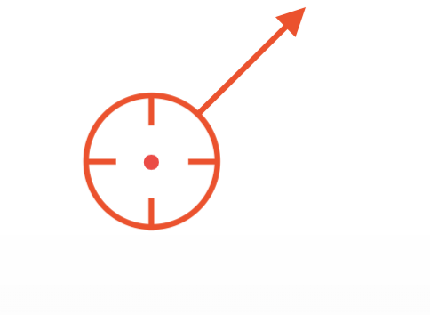

# I-005 — Moving position and heading challenge

[Idea index](../../IDEAS.md#i-005--guided-lessons-and-richer-practice)

Status: complete and accepted by the owner on 2026-10-21. All three stages are committed in `abce716`, `9877a3c`, and `9ed6913`. The [archived implementation plan](../Plans/I-005-Moving-Position-And-Heading-Challenge.md) preserves automated, normal-catalog, minimum-window, pointer/keyboard, and regression verification. Following the remaining sleep/wake reminder, the owner confirmed “COmmited and checked”; this is recorded as final review acceptance. Guided lessons and combined scoring remain later work.

## Purpose and requested experience

Add a second version of the existing Position Challenge. Keep the stationary exercise available, with the shared precise marker but no heading arrow. The new exercise tests three connected skills: finding position, determining heading, and completing both promptly. This version reports accuracy and time as separate measurements; combining them into a final score is deferred for the owner to consider.

The requested sequence is:

1. Before Begin or Try Again, none of the radios or exercise controls work. The player cannot tune the radios or prepare an estimate before starting the timed attempt.
2. Begin or Try Again starts the moving exercise and enables its controls. Finding the initial location is part of the timed attempt; there is no initial paused fix-taking stage.
3. Find the aircraft's current location using the navigation instruments and mark the estimated position.
4. Wait for movement to provide a later fix, determine heading, and enter that estimated heading through the indicator's control.
5. Update the position dot to the aircraft's new estimated location.
6. Press **Submit** to stop aircraft movement, lock the estimated position and heading, and end the measured attempt.
7. Show results comparing the submitted position and heading with the aircraft's actual state at submission.

The final estimate contains both position and heading. While the Mac is awake, active flight runs continuously at 1× until submission or chart exit. System sleep pauses both movement and elapsed time, and waking resumes the same attempt. The ending button is named **Submit**. Results use the same chart with a close comparison of the frozen estimate and actual aircraft state. Begin and Try Again remain working names for the starting and retry actions. A combined score is outside this version's scope.

The observation sequence is a recommended method, not app-enforced stages. During an active attempt, the player can tune the radios, drag the marker, and adjust estimated heading freely, with **Submit available throughout**. Do not require a first-fix confirmation, a heading-entry confirmation, or extra step buttons before submission.

Every newly randomized attempt resets radio tuning, both OBS settings, the estimated position and heading, and elapsed time. Settings from the previous exercise attempt do not carry over. Concrete reset values and treatment of chart preferences/camera remain to be specified in the implementation plan using the existing fresh-session defaults as the starting point.

Difficulty should come from fewer aids and better navigation decisions, not arbitrary controls. The chart must keep the answer hidden during the exercise. Myosia's bundled data and physical chart calibration remain authoritative.

## Settled flight conditions

- The first version uses still air, a constant heading, and a constant speed of **260 kt**.
- Wind is outside this version's scope. The player does not estimate wind or apply a wind correction.
- In these conditions, the direction of displacement between two position fixes is also the aircraft's heading. This keeps the exercise focused on finding fixes and inferring heading from movement.
- Start at 260 kt; the owner may adjust this value after trying the exercise. This is a starting design value, not a player-adjustable speed or a settled value for all future versions. At 1× it produces approximately 4.33 NM of travel per minute.
- Every new attempt, including Try Again, generates a fresh random starting position and a fresh random heading. Try Again does not replay the previous situation. Speed remains 260 kt and conditions remain still air.
- Validate the starting position and heading together so the first outward crossing of the **full source chart** cannot occur before **10 minutes (600 seconds)** of flight. At 260 kt in still air, this requires at least **43⅓ NM** of forward travel before chart exit. A position is not sufficient merely because it starts inside the chart; its direction must satisfy this buffer too. If the initial speed is later tuned, preserve the 600-second guarantee using the new speed.
- Whether the player sees the fixed speed remains open.

## Estimated position and heading marker

The current plane icon is too large and imprecise for this exercise. Use the owner's supplied reference as the direction for a different player-placement marker:

- The reference has a center dot, a surrounding circle with four inward ticks, and an outward arrow. The center gives a precise position reference; the arrow represents estimated heading.
- The player positions and updates the marker by dragging it. Clicking a new chart location must not reposition the marker's center.
- The draggable hit area includes the entire visible marker (including its arrow), all the space inside the circle, and a buffer around the marker. The player must not have to hit a visible line, tick, or center dot precisely. Thin strokes and transparent interior space must not create gaps in the draggable area.
- The numerical buffer size and hit-area behavior under chart zoom remain open. The graphic can stay visually precise while offering a larger, forgiving drag target.
- The heading indicator's control sets the arrow's direction, expressing the player's estimate. It must not reveal or steer the hidden aircraft's actual heading.
- Heading adjustments update the estimate and its arrow directly; the estimate does not turn gradually using the aircraft's simulated turn rate.
- Put a numeric heading readout below the indicator so the player can read the exact estimated heading. This readout shows the player's estimate, never the hidden aircraft's actual heading. Its exact label and formatting remain open.
- This differs from the current cockpit, where the heading indicator displays actual heading and its knob selects the aircraft's turn target. The new exercise needs an explicit presentation of estimated heading so its meaning is clear.
- There is exactly one player estimate marker. Dragging moves the entire marker to the updated estimated position. Nothing remains at the previous fix: no reference dot, saved fix, or marker trail.
- Aircraft simulation must not carry the estimate marker along with the hidden aircraft. The player updates its position by dragging and its heading through the indicator's control.
- Reuse the precise draggable circle, center dot, inward ticks, and forgiving hit area in the existing stationary Position Challenge, replacing its plane placement icon. **Omit the heading arrow in the stationary exercise** because it assesses position only; an arrow would imply an irrelevant heading task. This does not add heading assessment to the stationary exercise.
- Exact marker dimensions, color, and buffer size remain open. Shared use in both exercises, dragging, the broad continuous hit area, and the moving-only heading arrow are settled; the reference establishes the graphic concept, not settled pixel measurements.

## Chart aids

Keep the existing Practice chart aids available during the active attempt: radials, station range rings, grid, pan, and zoom. These help the player plot and read the instruments; they must not reveal the aircraft's true position or heading. This version does not add difficulty by removing these aids.

## Timing and accuracy

- Speed of completing the position-and-heading estimate is part of the skill, alongside position accuracy and heading accuracy.
- Once Begin or Try Again starts an attempt, the aircraft and attempt timer run continuously while the Mac is awake until Submit or chart exit. There is no player-operated Pause control and no playback-speed control. System sleep is the explicit automatic-pause exception.
- Show the running elapsed-time timer during the attempt, not only after Submit. The player can use it to judge the interval between observations and see the total time taken so far.
- Playback is fixed at 1×: one second of active elapsed time advances the simulation by one second. The player cannot accelerate flight to obtain more separation between fixes sooner.
- This version reports two result categories: **accuracy** and **time**. Accuracy consists of distance error in nautical miles and heading error in degrees. Time is the elapsed duration of the attempt. Show these three raw measurements without combining them into points, a grade, a ranking, or a pass/fail outcome.
- Combining accuracy and time into a final score is explicitly deferred for the owner to consider. Do not make completion time itself a qualifying score in this version.
- Retain the earlier scoring direction as a future design note: acceptable accuracy in **both** position and heading before rewarding faster completion, with provisional thresholds of **position error ≤ 5 NM** and **heading error ≤ 10°**. Those thresholds do not gate or classify results in this version and must be validated through flight trials before later scoring work.
- Awake elapsed time and simulated time advance together at 1×. Switching apps, losing window focus, or minimizing the window does not pause the aircraft or timer. On returning, the aircraft position and elapsed time must reflect uninterrupted awake-time flight.
- **System sleep pauses the simulation and attempt timer.** Do not count time spent asleep, move the aircraft through that interval, cancel the attempt, or produce an ending merely because the Mac slept. On wake, resume the same attempt from its pre-sleep position and elapsed time at 1×. This differs deliberately from app backgrounding and minimization.
- The authoritative attempt duration is awake elapsed time since Begin or Try Again, ending at Submit or the first outward full-chart crossing. The physical flight and displayed/result timer must use the same sleep-excluding time basis. Concrete clock and lifecycle handling belong in the implementation plan.

## Results and comparison zoom

- Submit stops movement and freezes the player's position-and-heading estimate alongside the aircraft's actual position and heading at that same submission instant.
- Keep the existing chart for results. Reveal the actual aircraft position and heading beside the frozen estimate marker, with distance error, heading error, and elapsed time in the Practice panel.
- Automatically zoom and center the results to show the difference closely. Both positions and their heading symbols must remain visible. Do not leave a small error visually lost at the previous chart scale.
- The owner's concern is that the icons overlap at ordinary chart zoom even when their positions differ. The result camera must support a closer view than the live chart's current 6× limit when needed; a precise upper bound is not yet chosen.
- Both **Estimate** and **Actual** use the owner's earlier circle-and-arrow graphic. Each circle center marks its corresponding position, and each arrow shows its corresponding heading. Do not use a directionless actual-position pin or replace either heading arrow with a numeric-only readout.
- Distinguish the two circle-and-arrow markers by color and line style, with separate **Estimate** and **Actual** labels. Keep both geographic centers exact; do not shift either position to separate its symbol.
- Exact or extremely close positions must remain readable through the distinct styles, separate labels, and numeric errors. Zoom alone cannot separate coincident centers. Manual inspection controls and refitting behavior remain open.

## Chart boundary and scenario validity

- If the aircraft leaves the full source chart before Submit, stop the attempt at its first outward boundary crossing and show the same frozen comparison results, labeled **Left the chart**.
- The generated start-and-heading pair must guarantee at least 10 minutes before that exit. This is a minimum time buffer, not a 10-minute attempt deadline; an attempt can continue past 10 minutes while the aircraft remains on the chart.
- The guarantee concerns the full chart boundary, not the current crop, pan, zoom, window size, or panel state.
- Guarantee at least **two in-range VORs at every point throughout the first 10 minutes (600 seconds)**, as well as no chart exit before that interval ends. This is a moving-path guarantee, not a check of the starting point alone. Whether the same pair must cover the entire interval is not specified; overlapping coverage from different stations can satisfy the station-count requirement.
- The current stationary generator checks station count at the starting point only; it does not validate a moving path. Do not silently substitute an invalid start-and-heading pair when a generation attempt fails. Generation failure behavior and any coverage guarantee after the initial 10 minutes remain open.
- A read-only feasibility check using bundled station positions/ranges found a valid 600-second eastbound segment at 260 kt: starting 260 NM east and 150 NM south of the full chart's top-left origin, it stays inside the chart and within CTR, NOR, and SNR range throughout. Both endpoints are inside each of those circular ranges, so the straight segment between them is covered. This confirms the requirements can coexist with current data; it is not validation of a future random generator.

## Technical shape

The existing physical flight model is the foundation for actual movement and chart-exit calculations. Keep two independent responsibilities:

- **Hidden flight truth:** actual starting position, constant actual heading, 260-kt motion in still air, continuous elapsed time, and boundary ending. Both NAV receivers read from the current true position. Normal play must not expose this position or heading through the chart, heading indicator, or marker orientation.
- **Player estimate:** the manually dragged position and heading entered with the indicator's control. Updating either must not change the hidden flight. The estimate marker does not automatically fly along its estimated heading.

The exercise owns its ready, active, and completed states, validates each random scenario before launch, and freezes true state, estimate, and elapsed duration at the same ending instant. System sleep suspends advancement of the active attempt without discarding it. The chart and instruments present that state; result-camera changes must not alter the frozen positions, headings, or measurements. Preserve the existing stationary exercise and the shared Free Flight and mission behavior.

This reuses the project's established simulation and chart foundations while keeping the moving exercise's estimate independent. Exact interfaces and changes belong in a later implementation plan.

## Behavior and foundations at the start of exploration

The README and source agreed on the stationary exercise when this exploration began. Stage 1 has since replaced its aircraft guess icon with the precise arrowless circle; Stage 2 adds the moving exercise through Debug Preview. The original foundations were:

- Practice currently has one actionable catalog entry, Position Challenge.
- The hidden target is separate from the draggable aircraft icon used as the guess. Both NAV receivers read from the hidden target, independently of where the player places the guess.
- Start Challenge chooses a new target, resets the guess to the chart center, and pauses the session. Target generation seeks at least three in-range stations, with a best-candidate fallback after 500 attempts.
- Check Placement reveals the target and the distance error in nautical miles. New Challenge resets the exercise.
- Flight simulation and its controls are omitted for this mode. The heading display and heading selection knob remain visible; the guess marker uses the session's heading.
- The shared flight model already supports actual and selected heading, airspeed, calm or steady wind, pause, elapsed simulated time, and playback multipliers. Its heading is the aircraft's nose direction; wind can make the ground track differ.
- The chart surface already separates reception position from the displayed guess and accepts mode-owned panel and overlay content. A moving exercise must preserve the distinction between hidden aircraft truth and the player's estimate.
- The live chart currently allows zoom from 1× to 6×. The mission debrief has a separate physical chart projection and inspection camera, so close result inspection has an existing in-project foundation. Its current fitting policy uses a minimum 10-NM span, which is not a settled fitting policy for this exercise's small position errors.
- The current shared live timing loop uses `ContinuousClock` to deliver elapsed intervals to the flight session. The new exercise's sleep-excluding timing requirement must be verified explicitly; reusing the existing timing loop by name alone does not establish the requested behavior.

There are no active implementation plans in `Design/Plans/` at the start of this exploration.

## Planning choices resolved in the implementation plan

The core purpose, flow, flight conditions, marker behavior, timing rules, results, and scenario guarantees are settled. The linked implementation plan now specifies the following choices; this list preserves the questions handed from exploration to planning without reopening the settled requirements:

1. **Clock and valid-scenario generation:** choose and verify a sleep-excluding time source that still advances during app switching/minimization; establish continuous coverage and chart-exit validation, finite generation behavior, and a clear retry state when no valid scenario is produced. Do not launch an invalid fallback. There is no agreed extra radio-coverage guarantee after the first 600 seconds; retain ordinary range behavior unless later work explicitly extends it.
2. **Controls and reset defaults:** specify radio/OBS and estimate reset values, chart preference/camera retention, and exact input gating before Begin and after completion. Radios and exercise inputs cannot be used before starting; the completed estimate must stay frozen. Results still need chart inspection. Whether the fixed speed is shown as a read-only reference remains open.
3. **Visual and camera details:** choose marker dimensions, drag buffer size, color/line styles, exact estimated-heading label/number formatting, comparison-camera limits and manual refit controls. The readout belongs below the indicator. Both positions and full heading arrows must fit in the initial automatic close-up, including tiny errors and coincident positions; numeric measurements remain authoritative. Do not rely on the existing 6× cap or 10-NM minimum fitting span without validating this requirement.
4. **Catalog wording and exit navigation:** give the second exercise a clear Practice entry while retaining Position Challenge, settle the start/retry wording, and specify leaving an unfinished attempt. Submit is the confirmed ending-action label. Do not add persistence, a leaderboard, or scoring as an incidental solution to these details.

## Delivered and accepted bounded slice

The [implementation plan](../Plans/I-005-Moving-Position-And-Heading-Challenge.md) has delivered the playable moving position-and-heading exercise under Practice, plus the shared precise arrowless marker in the stationary exercise. It separates hidden truth from estimates, proves initial scenario validity, uses an awake-time clock, and provides a frozen comparison with exact centers. The final catalog implementation is committed in `9ed6913`; the owner has confirmed the outstanding review. This bounded record and its plan are archived, with later guided lessons and scoring kept outside the completed scope.

The owner must be able to try the slice through the normal Practice catalog: start, tune, drag, enter heading, observe the running timer, Submit, inspect the automatically zoomed two-arrow result, and Try Again with a new situation. The stationary catalog entry must also provide the precise draggable circle with no arrow. Early visual review should make the marker's interior and buffer easy to test, and make close, coincident, and widely separated result markers inspectable without waiting for a complete flight each time. These are user-visible review outcomes, not a file-level build checklist.

Flight review must confirm the chosen 260-kt pace, physical distance and heading measurements, the initial 600-second validity guarantee, continued advancement while backgrounded/minimized, and pause/resume across actual system sleep. The 5-NM/10° values remain notes for future scoring, not acceptance tolerances for altering navigation data or physics.

## Deferred scope

Combining position error, heading error, and elapsed time into a final score is deferred for the owner to consider. The earlier accuracy-first direction and provisional 5-NM/10° thresholds are retained as future design notes, not requirements to implement scoring in this version.

The wider I-005 initiative still includes guided lessons for reading a VOR, finding position with two VORs, and intercepting or tracking a radial. Those activities are outside this bounded exploration.
